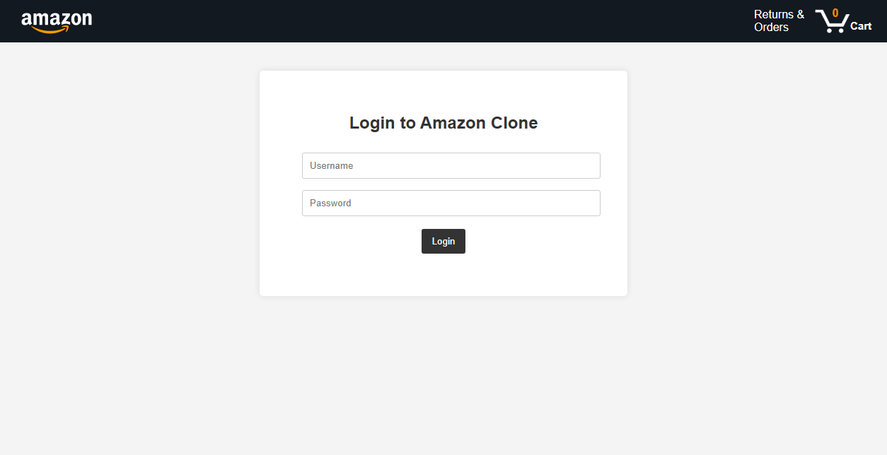
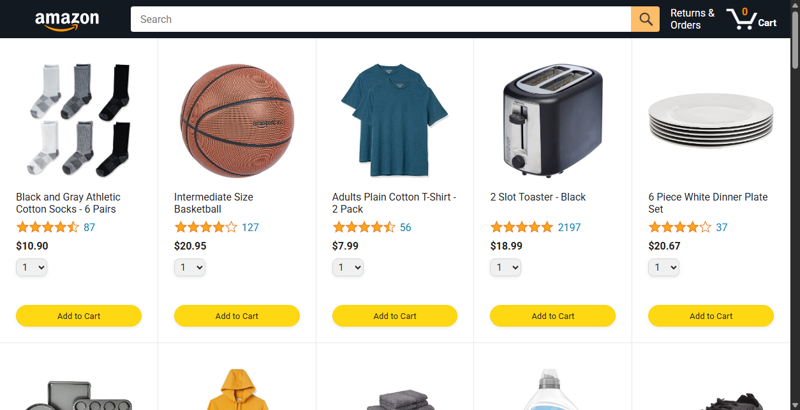
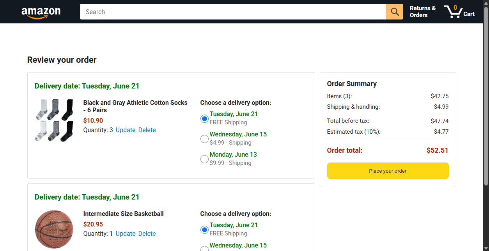
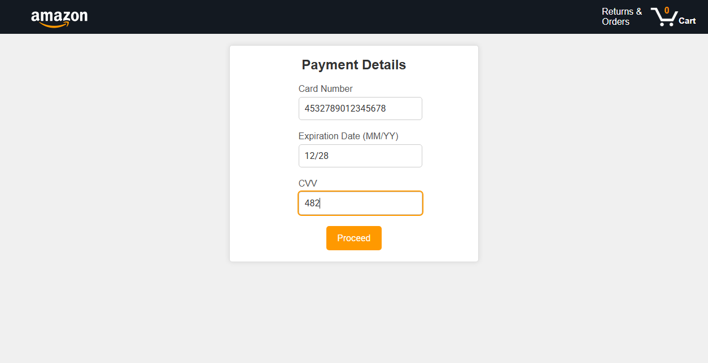
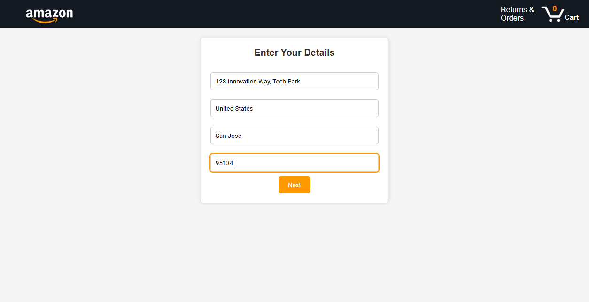
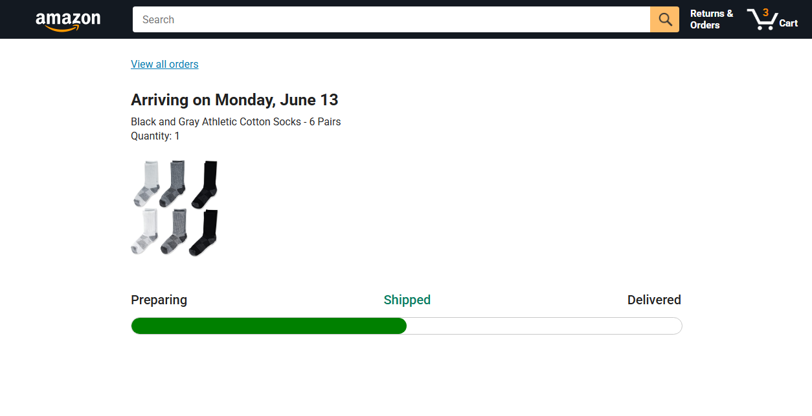

# Software Testing & Quality Assurance (STQA) Mini Project
**Automated Regression Testing & Bug Identification of E-Commerce Web Application (Amazon Clone)**  
*Semester 7 — Computer Engineering*

---

## 📌 Project Overview
This repository contains a full-featured automated regression testing suite and quality assurance documentation for a multi-page **Amazon Clone Web Application**. The project leverages **Selenium WebDriver** in conjunction with **Node.js** and **ChromeDriver** to perform functional, regression, boundary value, and exploratory testing across all primary user flows.

---

## 📑 Core Deliverables

- **Comprehensive Test Plan & Bug Taxonomy**: [`TEST_PLAN_AND_BUG_TAXONOMY.md`](./TEST_PLAN_AND_BUG_TAXONOMY.md)  
  *Contains IEEE 829-aligned test plan, 5-tier bug taxonomy, defect lifecycle, Requirements Traceability Matrix (RTM), and exploratory testing charters.*
- **Automated Regression Suite**: Located in [`tests/`](./tests) (20+ test scripts across 7 modules).
- **Embedded Local Server**: [`server.js`](./server.js) (Serves the application locally on port 5501).
- **Automated Test Runner & Screenshot Generator**: [`capture_screenshots.js`](./capture_screenshots.js).

---

## 🛠️ System Environment & Technologies
- **Operating System:** Windows 10/11 x64
- **Runtime:** Node.js (v18+) & npm
- **Automation Framework:** `selenium-webdriver` (v4.14+) & ChromeDriver
- **Frontend Stack:** HTML5, CSS3, JavaScript (ES6 Modules)
- **Application Server:** Node.js HTTP server at `http://127.0.0.1:5501/`

---

## 📂 Repository Structure

```
STQA mini/
├── backend/
│   └── products.json                # Catalog data store
├── data/
│   ├── cart.js                      # Cart state management
│   └── products.js                  # Product data models
├── images/                          # UI icons and product media assets
├── scripts/
│   ├── amazon.js                    # Homepage product catalog logic
│   ├── checkout.js                  # Cart calculation & deletion logic
│   └── utils/                       # Currency formatting utilities
├── styles/                          # CSS stylesheets (general, headers, checkout)
├── tests/                           # Selenium WebDriver regression test suites
│   ├── address/                     # Address form validations (test1.js - test5.js)
│   ├── cart/                        # Cart manipulation (delete.test.js)
│   ├── homepage/                    # Product grid rendering (test1.js)
│   ├── login/                       # Credential validations (login.test1.js - login.test4.js)
│   ├── navigation/                  # Header & page routing (nav.test1.js - nav.test5.js)
│   ├── payment/                     # Payment card validations (test1.js - test4.js)
│   └── tracking/                    # Order tracking status (tracking.test1.js - test6.js)
├── screenshots/                     # Live execution screenshot captures
├── amazon.html                      # Homepage & product catalog
├── checkout.html                    # Order review & cart checkout
├── login.html                       # User authentication portal
├── orders.html                      # Returns & past orders
├── payments.html                    # Payment details gateway
├── tracking.html                    # Real-time package delivery tracking
├── user_details.html                # Shipping address details
├── server.js                        # Local test HTTP server
├── capture_screenshots.js           # Automated test & visual artifact runner
├── TEST_PLAN_AND_BUG_TAXONOMY.md    # Formal IEEE 829 Test Plan & Bug Taxonomy
└── package.json                     # Project dependencies & scripts
```

---

## 🚀 Getting Started

### 1. Installation
Clone the repository and install dependencies:
```bash
git clone https://github.com/UjwalTikhe/STQA-mini_project.git
cd STQA-mini_project
npm install
```

### 2. Start the Local Server
The Selenium test scripts target `http://127.0.0.1:5501/`. Start the local server:
```bash
node server.js
```
The application will be live at `http://127.0.0.1:5501/login.html`.

### 3. Run Automated Regression Tests
Run individual module tests:
```bash
# Test user authentication
node tests/login/login.test1.js

# Test shipping address validations
node tests/address/test1.js

# Test cart item deletion
node tests/cart/delete.test.js

# Test payment processing
node tests/payment/test1.js
```

### 4. Capture Test Execution Screenshots
To automatically run the entire flow and capture high-resolution screenshots:
```bash
node capture_screenshots.js
```
Screenshots are saved to the [`screenshots/`](./screenshots) directory.

---

## 📸 Test Execution Highlights

| 1. Authentication Portal | 2. Product Catalog & Cart Counter |
| :---: | :---: |
|  |  |
| **3. Order Review & Checkout** | **4. Payment Gateway Form** |
|  |  |
| **5. Shipping Address Form** | **6. Shipment Status & Tracking** |
|  |  |

---

## 🐛 Bug Taxonomy & Defects Identified
During the automated Selenium regression test cycle, four primary defects were logged:
1. **CAT-SEC-001 (Severity S1 - Blocker):** Client-side hardcoded credentials and missing session protection on internal pages (`amazon.html`).
2. **CAT-NAV-002 (Severity S2 - Major):** Hardcoded absolute URL redirection (`http://127.0.0.1:5501/amazon.html`) breaking port-agnostic serving.
3. **CAT-VAL-003 (Severity S2 - Major):** Permissive month regular expression in payment card processing accepting invalid months (e.g. `99/25`).
4. **CAT-FUN-004 (Severity S3 - Moderate):** Header search bar button disabled with unhandled input filtering events.

For full bug logs, reproduction steps, and root-cause analysis, refer to [`TEST_PLAN_AND_BUG_TAXONOMY.md`](./TEST_PLAN_AND_BUG_TAXONOMY.md).

---

## 📜 References & Acknowledgements
- [Selenium WebDriver Documentation](https://www.selenium.dev/documentation/webdriver/)
- [ChromeDriver Chromium Guide](https://chromedriver.chromium.org/getting-started)
- Frontend design inspired by SuperSimpleDev JavaScript curriculum.
