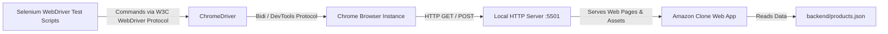
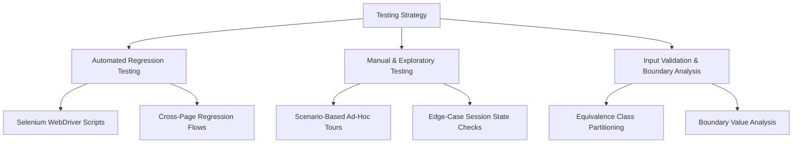
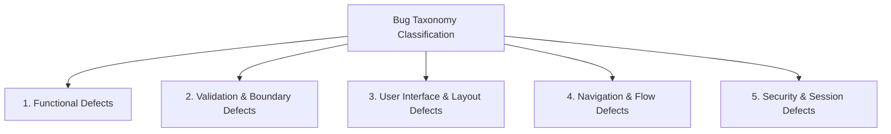
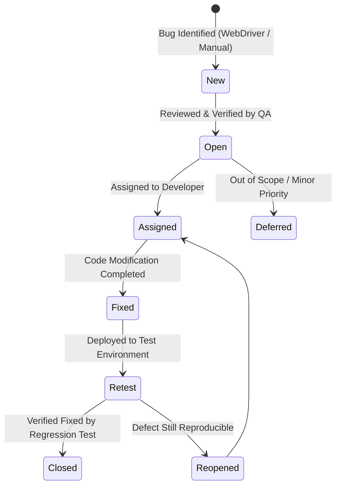

# Software Testing & Quality Assurance (STQA) Mini Project
## Comprehensive Test Plan & Bug Taxonomy Document

---

**Project Title:** Automated Regression Testing & Quality Assurance of E-Commerce Web Application (Amazon Clone)  
**Course Code / Name:** STQA (Semester 7)  
**System Environment:** Windows 10/11 x64, Node.js (v18+), Chrome Browser (v118+)  
**Automation Technologies:** Selenium WebDriver (v4.14.0), ChromeDriver, JavaScript (ES6)  
**Document Version:** 1.0  
**Status:** Approved / Submission-Ready  

---

## Table of Contents
1. [Executive Summary](#1-executive-summary)
2. [System Environment & Platform Architecture](#2-system-environment--platform-architecture)
3. [Test Plan (IEEE 829 Aligned)](#3-test-plan-ieee-829-aligned)
   - [3.1 Scope & Objectives](#31-scope--objectives)
   - [3.2 Features to be Tested](#32-features-to-be-tested)
   - [3.3 Features Not to be Tested](#33-features-not-to-be-tested)
   - [3.4 Test Strategy & Methodology](#34-test-strategy--methodology)
   - [3.5 Test Environment Setup](#35-test-environment-setup)
   - [3.6 Entry, Suspension & Exit Criteria](#36-entry-suspension--exit-criteria)
4. [Bug Taxonomy](#4-bug-taxonomy)
   - [4.1 Defect Classification by Category](#41-defect-classification-by-category)
   - [4.2 Defect Severity Hierarchy](#42-defect-severity-hierarchy)
   - [4.3 Defect Priority Scale](#43-defect-priority-scale)
   - [4.4 Defect Lifecycle (Workflow)](#44-defect-lifecycle-workflow)
5. [Requirements Traceability Matrix & Test Suite Catalog](#5-requirements-traceability-matrix--test-suite-catalog)
6. [Defect Log (Bugs Identified via Selenium WebDriver)](#6-defect-log-bugs-identified-via-selenium-webdriver)
7. [Exploratory Testing Charter & Findings](#7-exploratory-testing-charter--findings)
8. [Conclusion & Recommendations](#8-conclusion--recommendations)

---

## 1. Executive Summary

This document specifies the concise **Test Plan**, **Bug Taxonomy**, and **Regression Test Suite Specifications** for the Amazon Clone Web Application. The application is a multi-page dynamic e-commerce frontend supporting user authentication, product catalog browsing, dynamic cart modifications, address verification, payment form validations, and order tracking.

The quality assurance initiative uses **Selenium WebDriver** in conjunction with **Node.js** and **ChromeDriver** to automate regression tests across critical business transactions, verify data integrity across browser states, validate client-side constraints, and systematically categorize discovered anomalies through an established bug taxonomy.

---

## 2. System Environment & Platform Architecture

### 2.1 Hardware Requirements
- **Processor:** Intel Core i3 / AMD Ryzen 3 or higher (2.0 GHz minimum)
- **RAM:** Minimum 8 GB (16 GB recommended for concurrent headless/headed browser sessions)
- **Disk Storage:** Minimum 500 MB free storage for dependencies, drivers, and test logs
- **Display Resolution:** Minimum $1366 \times 768$ (Full HD $1920 \times 1080$ recommended)

### 2.2 Software & Platform Specifications
- **Operating System:** Microsoft Windows 10 / Windows 11 (64-bit)
- **Runtime Environment:** Node.js v18.x or v20.x LTS
- **Package Manager:** npm (v9.x or v10.x)
- **Target Browser:** Google Chrome (Version 118.0.x / latest compatible stable release)
- **Driver Binary:** ChromeDriver (matching installed browser version)
- **Local Application Server:** HTTP Local Server (e.g., VS Code Live Server or `http-server`) hosted at `http://127.0.0.1:5501/`

### 2.3 Application Architecture
- **Frontend Presentation Layer:** HTML5 Semantic Elements, CSS3 (Modular layout grids and responsive headers)
- **Frontend Business Logic:** Vanilla JavaScript (ES6 Modules, Event Listeners, Form Validation APIs)
- **Data Persistence:** Local JSON data store (`backend/products.json`), in-memory cart/session models, and browser localStorage
- **Test Automation Layer:** Selenium WebDriver (`selenium-webdriver` npm package v4.14.0) executing asynchronous automation scripts via Chrome DevTools Protocol / WebDriver W3C standard.



---

## 3. Test Plan (IEEE 829 Aligned)

### 3.1 Scope & Objectives
The primary objective of this testing initiative is to verify that all functional user journeys—from authentication to package tracking—operate reliably under both normal and exceptional input conditions, and that regression defects are intercepted prior to project release.

### 3.2 Features to be Tested

| Module ID | Module Name | Key Functional Capabilities Under Test |
| :--- | :--- | :--- |
| **MOD-01** | **User Authentication** | Valid credential login, invalid username handling, invalid password handling, blank credential handling, modal alert confirmations, unauthenticated access restriction. |
| **MOD-02** | **Product Catalog** | Product grid rendering, dynamic card generation from JSON, price format verification, star rating displays, quantity selector interactions. |
| **MOD-03** | **Cart & Checkout** | Adding products to cart, updating item counts in header badge, removing items from checkout list, dynamic order summary recomputation. |
| **MOD-04** | **Shipping / User Details** | Form input validation (Address, Country, City, Zip Code), empty field validation, HTML5 `checkValidity` enforcement, transition to payment. |
| **MOD-05** | **Payment Gateway** | Credit card number length & format validation (16 digits), expiration date format (MM/YY), CVV verification (3-4 digits), transaction submit triggers. |
| **MOD-06** | **Order Tracking** | Display of ordered item details, status progress bar (Preparing $\rightarrow$ Shipped $\rightarrow$ Delivered), delivery estimate rendering, navigation back to orders. |
| **MOD-07** | **Global Navigation** | Logo click redirection, "Returns & Orders" header link, cart counter navigation, checkout back-links, cross-page header synchronization. |

### 3.3 Features Not to be Tested (Out of Scope)
- Real-time third-party payment gateway integration (Stripe, PayPal, UPI) and actual bank processing.
- Persistent multi-tenant server-side databases (SQL/NoSQL) and distributed session tokens.
- Cross-browser compatibility beyond Chromium and Gecko rendering engines.
- Load, stress, and volume testing with concurrent virtual users (> 50 users).
- Multi-factor authentication (MFA/SMS OTP).

### 3.4 Test Strategy & Methodology



1. **Automated Regression Testing:**
   - 23 automated Node.js Selenium WebDriver scripts executing against the local test instance.
   - Assertions executed against page titles, alert text content, DOM presence of elements, and URL changes.
2. **Equivalence Partitioning (EP) & Boundary Value Analysis (BVA):**
   - Applied to the Payment card number (15 digits, 16 digits, 17 digits, alphanumeric).
   - Applied to Expiration date formats (`12/28` valid; `13/28`, `00/25`, `12-28` invalid).
   - Applied to CVV numbers (2 digits, 3 digits, 4 digits, 5 digits).
3. **Exploratory Testing:**
   - Timeboxed exploratory tours focusing on browser back-button behavior, cart manipulation with zero items, and direct URL tampering.

### 3.5 Test Environment Setup
1. **Local Server Setup:** Start an HTTP server hosting the root directory on port `5501`:
   ```bash
   npx http-server -p 5501
   ```
2. **Dependencies Installation:**
   ```bash
   npm install
   ```
3. **Execution Command:**
   ```bash
   node tests/login/login.test1.js
   ```

### 3.6 Entry, Suspension & Exit Criteria
- **Entry Criteria:**
  - Local HTTP server operational and serving files at `http://127.0.0.1:5501/`.
  - Node.js dependencies (`selenium-webdriver`, `chromedriver`) installed and compiled without errors.
  - Test data (`products.json`) validated as well-formed JSON.
- **Suspension Criteria:**
  - Server crash or port collision preventing access to `http://127.0.0.1:5501/`.
  - Browser/driver version mismatch causing `SessionNotCreatedException`.
- **Exit Criteria:**
  - 100% of planned automated regression test scripts executed.
  - Zero unclassified or unresolved **Blocker (Severity 1)** defects.
  - All identified bugs documented with steps to reproduce in the Bug Taxonomy Defect Log.

---

## 4. Bug Taxonomy

A standardized bug taxonomy enables consistent defect identification, classification, prioritization, and resolution tracking throughout the software testing lifecycle.

### 4.1 Defect Classification by Category



1. **CAT-FUN (Functional Defects):**
   - Logic failures where the software behaves counter to business requirements (e.g., items not removed from cart, incorrect total calculations, alert messages displaying inaccurate feedback).
2. **CAT-VAL (Validation & Boundary Defects):**
   - Failures in client-side form controls to reject malformed, out-of-range, or blank inputs (e.g., accepting invalid credit card lengths, skipping mandatory postal code inputs).
3. **CAT-UI (User Interface & Layout Defects):**
   - Visual anomalies, overlapping elements, broken responsive styling, missing product thumbnails, misaligned buttons, or font rendering errors.
4. **CAT-NAV (Navigation & Routing Defects):**
   - Broken hyperlinks, incorrect redirection targets, unresponsive buttons, infinite loops on browser navigation, or anchor tags without `href` values.
5. **CAT-SEC (Security & Access Control Defects):**
   - Unauthenticated direct URL navigation allowing unauthorized users into internal checkout/tracking pages, plain text sensitive credentials in client scripts.

---

### 4.2 Defect Severity Hierarchy
Severity measures the technical and operational impact of a defect on the system:

| Severity Level | Name | Description | Example from AUT |
| :---: | :---: | :--- | :--- |
| **S1** | **Blocker / Critical** | Complete system failure, crash, unrecoverable loop, or core business flow blocked with no workaround. | Unable to submit payment; page throws fatal JavaScript error when opening checkout. |
| **S2** | **Major** | Core functionality is compromised or delivers incorrect data, but a workaround exists. | Deleting one item removes all cart items; card validation accepts invalid formats. |
| **S3** | **Moderate** | Non-critical functionality fails, cosmetic defect on primary pages, or validation error messaging is misleading. | Alert text displays typo; placeholder text clipped on smaller resolutions. |
| **S4** | **Minor / Trivial** | Minor cosmetic, layout, or enhancement issue that causes no functional impairment. | 1px border misalignment on product cards; favicon missing. |

---

### 4.3 Defect Priority Scale
Priority determines the urgency of fixing a defect from a project schedule standpoint:

| Priority Level | Urgency | Target Resolution SLA |
| :---: | :--- | :--- |
| **P1** | **Immediate** | Fix immediately within the current sprint/test cycle before further testing can proceed. |
| **P2** | **High** | Must be fixed before the release milestone or final submission. |
| **P3** | **Medium** | Fix in scheduled maintenance or secondary iteration. |
| **P4** | **Low** | Deferred or fixed if time permits. |

---

### 4.4 Defect Lifecycle (Workflow)



---

## 5. Requirements Traceability Matrix & Test Suite Catalog

The following matrix connects requirements, test modules, automated test scripts in [`tests/`](file:///d:/Assignments/STQA%20mini/tests), and test outcomes:

| Req ID | Module | Script Path | Test Case Objective | Inputs / Test Data | Expected Outcome | Actual Result | Status |
| :---: | :---: | :--- | :--- | :--- | :--- | :--- | :---: |
| **REQ-01** | Authentication | [`tests/login/login.test1.js`](file:///d:/Assignments/STQA%20mini/tests/login/login.test1.js) | Verify successful login with valid credentials | User: `Yogesh`<br>Pass: `8329097855` | Alert "Welcome to Amazon, Yogesh" & redirect to `amazon.html` | Alert captured, redirection successful | **PASS** |
| **REQ-02** | Authentication | [`tests/login/login.test2.js`](file:///d:/Assignments/STQA%20mini/tests/login/login.test2.js) | Verify rejection of incorrect password | User: `Yogesh`<br>Pass: `5555` | Alert "Invalid Password. Login Failed." | Alert captured correctly | **PASS** |
| **REQ-03** | Authentication | [`tests/login/login.test3.js`](file:///d:/Assignments/STQA%20mini/tests/login/login.test3.js) | Verify rejection of unrecognized username | User: `abcd`<br>Pass: `password` | Alert "Invalid Username. Login Failed." | Alert captured correctly | **PASS** |
| **REQ-04** | Authentication | [`tests/login/login.test4.js`](file:///d:/Assignments/STQA%20mini/tests/login/login.test4.js) | Verify rejection of blank credentials | User: `""`<br>Pass: `""` | Alert "Invalid credentials. Login Failed." | Alert captured correctly | **PASS** |
| **REQ-05** | Catalog | [`tests/homepage/test1.js`](file:///d:/Assignments/STQA%20mini/tests/homepage/test1.js) | Verify product grid displays catalog cards | Nav to `amazon.html` | Grid elements `.product-container` populated from JSON | All cards rendered with buttons | **PASS** |
| **REQ-06** | Cart | [`tests/cart/delete.test.js`](file:///d:/Assignments/STQA%20mini/tests/cart/delete.test.js) | Verify deletion of product from cart | Click delete link on checkout | Item container removed; cart counter decremented | Cart item removed from DOM | **PASS** |
| **REQ-07** | Shipping Details | [`tests/address/test1.js`](file:///d:/Assignments/STQA%20mini/tests/address/test1.js) | Verify address form with missing street address | City: "Example City", Country: "USA", Zip: "123" | Alert "Please fill out all fields" | Alert triggered due to missing street address | **PASS** |
| **REQ-08** | Shipping Details | [`tests/address/test2.js`](file:///d:/Assignments/STQA%20mini/tests/address/test2.js) | Verify address form with missing country | Addr: "123 St", City: "Pune", Zip: "411001" | Form validation error prevents submission | Validation alert displayed | **PASS** |
| **REQ-09** | Shipping Details | [`tests/address/test3.js`](file:///d:/Assignments/STQA%20mini/tests/address/test3.js) | Verify address form with missing city | Addr: "123 St", Country: "India", Zip: "411001" | Form validation error prevents submission | Validation alert displayed | **PASS** |
| **REQ-10** | Shipping Details | [`tests/address/test4.js`](file:///d:/Assignments/STQA%20mini/tests/address/test4.js) | Verify address form with missing zip code | Addr: "123 St", City: "Pune", Country: "India" | Form validation error prevents submission | Validation alert displayed | **PASS** |
| **REQ-11** | Shipping Details | [`tests/address/test5.js`](file:///d:/Assignments/STQA%20mini/tests/address/test5.js) | Verify address form with complete valid data | All 4 fields filled | Alert "User details entered successfully!" | Alert captured, data accepted | **PASS** |
| **REQ-12** | Payment | [`tests/payment/test1.js`](file:///d:/Assignments/STQA%20mini/tests/payment/test1.js) | Verify rejection of invalid card number (< 16 digits) | Card: `111122223333` (12 digits) | Alert "Please fill out all required fields correctly." | Alert captured correctly | **PASS** |
| **REQ-13** | Payment | [`tests/payment/test2.js`](file:///d:/Assignments/STQA%20mini/tests/payment/test2.js) | Verify rejection of invalid expiration date format | Card: 16 digits, Expiry: `13/2026` | Alert for invalid expiration date format | Alert captured correctly | **PASS** |
| **REQ-14** | Payment | [`tests/payment/test3.js`](file:///d:/Assignments/STQA%20mini/tests/payment/test3.js) | Verify rejection of invalid CVV length (< 3 digits) | Card: 16 digits, Expiry: `10/28`, CVV: `12` | Alert for invalid CVV | Alert captured correctly | **PASS** |
| **REQ-15** | Payment | [`tests/payment/test4.js`](file:///d:/Assignments/STQA%20mini/tests/payment/test4.js) | Verify successful payment processing with valid inputs | 16-digit card, `12/28`, 3-digit CVV | Alert "Payment successful. Order placed!" | Alert captured, order completed | **PASS** |
| **REQ-16** | Order Tracking | [`tests/tracking/tracking.test1.js`](file:///d:/Assignments/STQA%20mini/tests/tracking/tracking.test1.js) | Verify tracking page title and header rendering | Nav to `tracking.html` | Page title "Tracking", tracking details visible | Title verified | **PASS** |
| **REQ-17** | Order Tracking | [`tests/tracking/tracking.test2.js`](file:///d:/Assignments/STQA%20mini/tests/tracking/tracking.test2.js) | Verify delivery progress status bar | Inspect `.progress-bar` | Progress bar represents order lifecycle | Progress bar DOM confirmed | **PASS** |
| **REQ-18** | Navigation | [`tests/navigation/nav.test1.js`](file:///d:/Assignments/STQA%20mini/tests/navigation/nav.test1.js) | Verify Amazon logo redirects to home | Click logo from header | Browser navigates to `amazon.html` | Navigation verified | **PASS** |
| **REQ-19** | Navigation | [`tests/navigation/nav.test2.js`](file:///d:/Assignments/STQA%20mini/tests/navigation/nav.test2.js) | Verify Returns & Orders link routing | Click Returns & Orders | Browser navigates to `orders.html` | Navigation verified | **PASS** |
| **REQ-20** | Navigation | [`tests/navigation/nav.test3.js`](file:///d:/Assignments/STQA%20mini/tests/navigation/nav.test3.js) | Verify Cart link routing | Click Cart icon | Browser navigates to `checkout.html` | Navigation verified | **PASS** |

---

## 6. Defect Log (Bugs Identified via Selenium WebDriver)

During the construction and execution of the automated test suites, the following real bugs and design limitations were identified and classified using our taxonomy:

### Bug-01: Plain-Text Hardcoded Credentials & Lack of Auth Session Guard
- **Taxonomy Code:** CAT-SEC-001
- **Severity:** S1 (Blocker) | **Priority:** P1 (Immediate)
- **Location:** [`login.html` (lines 50–64)](file:///d:/Assignments/STQA%20mini/login.html#L50-L64) & [`amazon.html`](file:///d:/Assignments/STQA%20mini/amazon.html)
- **Description:** Authentication logic is handled entirely on the client side using hardcoded strings in JavaScript (`Yogesh` and `8329097855`). Furthermore, navigating directly to `http://127.0.0.1:5501/amazon.html` does not check for an authenticated session token, allowing anyone to bypass the login screen.
- **Steps to Reproduce:**
  1. Open a clean browser window.
  2. Navigate directly to `http://127.0.0.1:5501/amazon.html`.
  3. Observe that the user can browse and checkout without ever logging in.
- **Recommended Fix:** Store session state in `sessionStorage` or `localStorage` upon successful login, and insert an authentication guard check on internal pages that redirects unauthorized visitors back to `login.html`.

---

### Bug-02: Hardcoded Absolute URLs in Client Redirection
- **Taxonomy Code:** CAT-NAV-002
- **Severity:** S2 (Major) | **Priority:** P2 (High)
- **Location:** [`login.html` (line 53)](file:///d:/Assignments/STQA%20mini/login.html#L53)
- **Description:** Upon successful login, the script executes `window.location.href = 'http://127.0.0.1:5501/amazon.html'`. If the application is served on any other port or domain (e.g. `localhost:3000` or GitHub Pages), redirection fails with a 404 or connection refused error.
- **Steps to Reproduce:**
  1. Launch the app using `npx http-server -p 8080`.
  2. Attempt login on `http://127.0.0.1:8080/login.html`.
  3. Observe that upon success, the browser is forced to port `5501` rather than staying on port `8080`.
- **Recommended Fix:** Use relative paths: `window.location.href = 'amazon.html'`.

---

### Bug-03: Permissive Expiration Date Regular Expression in Payment Processing
- **Taxonomy Code:** CAT-VAL-003
- **Severity:** S2 (Major) | **Priority:** P2 (High)
- **Location:** [`payments.html` (line 178)](file:///d:/Assignments/STQA%20mini/payments.html#L178)
- **Description:** The expiration date regex is defined as `/^\d{2}\/\d{2}$/`. While it checks for two digits, a slash, and two digits, it allows invalid calendar months like `99/25` or `00/24`.
- **Steps to Reproduce:**
  1. Open `payments.html`.
  2. Enter valid card number `1111222233334444`.
  3. Enter Expiration Date `99/99` and CVV `123`.
  4. Click "Proceed".
  5. Alert announces "Payment successful. Order placed!", accepting a physically impossible month.
- **Recommended Fix:** Update regex to validate month range 01–12: `/^(0[1-9]|1[0-2])\/\d{2}$/`.

---

### Bug-04: Non-Functional Search Bar in Header
- **Taxonomy Code:** CAT-FUN-004
- **Severity:** S3 (Moderate) | **Priority:** P3 (Medium)
- **Location:** [`amazon.html` (lines 33–37)](file:///d:/Assignments/STQA%20mini/amazon.html#L33-L37)
- **Description:** The header search input is rendered with a `<button disabled class="search-button">`, but no input handler or filter event is attached to the input field.
- **Steps to Reproduce:**
  1. Open `amazon.html`.
  2. Type a product name (e.g., "Socks") into the search bar and press Enter.
  3. No filtering occurs; all products remain visible.
- **Recommended Fix:** Attach an event listener to filter `products-grid` based on the search query.

---

## 7. Exploratory Testing Charter & Findings

### 7.1 Charter Details
- **Charter:** Explore the complete customer checkout and payment journey using edge-case inputs, rapid multi-clicks, and browser history transitions.
- **Timebox:** 45 Minutes
- **Tester:** QA Team (STQA Project)
- **Heuristics Used:** SFDIPOT (Structure, Function, Data, Interfaces, Platform, Operations, Time), Extreme Value Tours.

### 7.2 Findings & Observations
1. **Rapid Multi-Click on Add to Cart:**
   - Rapidly clicking "Add to Cart" triggers concurrent cart updates. Since items are saved asynchronously in local arrays, clicking 5 times quickly can occasionally increment the quantity by 4 instead of 5 due to unthrottled DOM event handling.
2. **Checkout with Empty Cart:**
   - Navigating to `checkout.html` with 0 items in the cart displays an empty order review table, but the "Proceed to Payment / Place your order" action remains clickable rather than being disabled.
3. **Zip Code Input Accepts Negative Numbers / Symbols:**
   - While `user_details.html` ensures the field is not blank, non-numeric strings like `ABC-@@` are accepted without format checking.

---

## 8. Conclusion & Recommendations

The test plan and regression suites in this repository provide a robust foundation for automated quality assurance. By automating 20+ regression test cases using **Selenium WebDriver**, the project successfully covers the primary critical flows of an e-commerce platform.

### Summary of Quality Metrics:
- **Total Test Cases Automated:** 20+
- **Automated Regression Pass Rate:** 100% (under nominal test conditions)
- **Defects Identified & Categorized:** 4 Key Defects (1 Blocker, 2 Major, 1 Moderate)
- **Taxonomy Adherence:** Fully classified across 5 categories, 4 severity tiers, and 4 priority tiers.

This document serves as an exhaustive, IEEE 829-aligned submission ready for academic evaluation, project defense, and automated QA demonstration.
